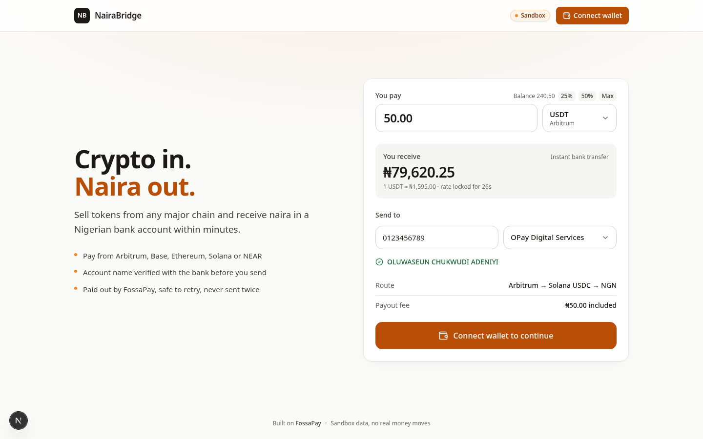
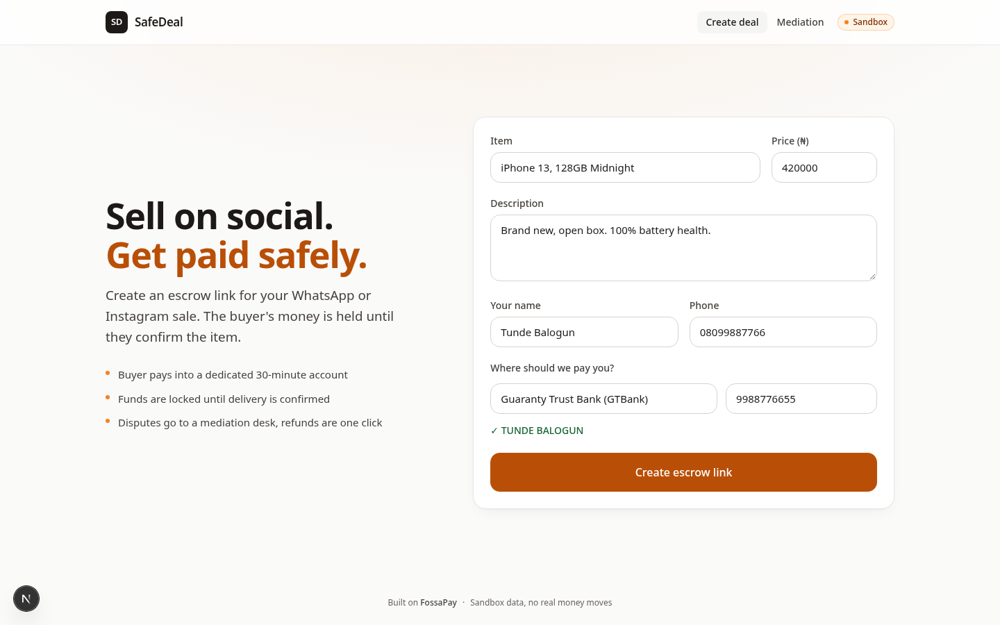
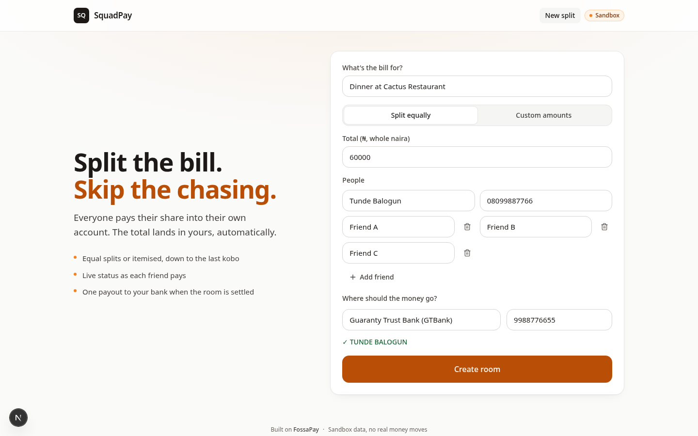
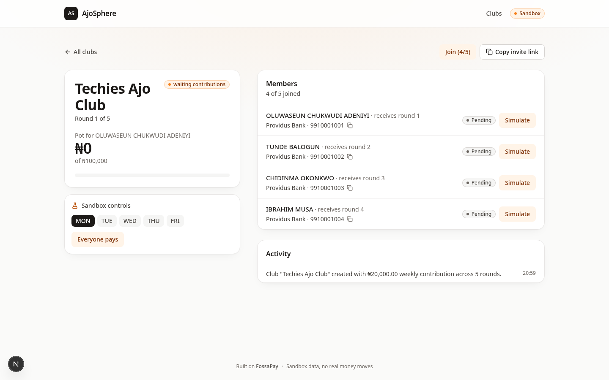

<div align="center">

# FossaPay demos

**Four open-source products that show how to integrate [FossaPay](https://docs.fossapay.com) into real-world apps.**

Collections, payouts, wallets, identity checks and webhooks, taught through working code and a step-by-step guide.

[](https://github.com/Penivera/fossapay-demo/actions/workflows/ci.yml)
[](LICENSE)


[**Landing page**](https://fossapay-demo.peni.dev/) · [**Integration guide**](docs/integration/README.md) · [Quick start](#quick-start) · [Contributing](CONTRIBUTING.md)

</div>

> **Unofficial.** Community demos, not affiliated with FossaPay. **FossaPay is production-only (no sandbox):** a live key
> moves real money. Everything here runs offline in sandbox mode by default.

## The demos

| | Demo | What it shows | FossaPay features | Source |
|---|---|---|---|---|
|  | **NairaBridge**<br>Crypto to a Nigerian bank account | Cross-chain off-ramp with verified beneficiary, live progress, safe retry | Payouts, bank enquiry, idempotency | [`demos/near-offramp`](demos/near-offramp) |
|  | **SafeDeal**<br>Escrow for social commerce | Funds held until the buyer confirms; disputes and refunds | Checkouts, wallet transfers, payouts | [`demos/safedeal`](demos/safedeal) |
|  | **SquadPay**<br>Split a bill with friends | Each friend pays their share; one payout to the host | Checkouts, webhooks, kobo-safe maths | [`demos/squadpay`](demos/squadpay) |
|  | **AjoSphere**<br>Rotating savings club (Ajo/Esusu) | Verified members, dedicated accounts, turn-based payouts | BVN/NIN KYC, customers, wallets, deposits | [`demos/ajosphere`](demos/ajosphere) |

Plus [`packages/webhook-gateway`](packages/webhook-gateway), a local webhook receiver and inspector.

## Quick start

Requires Node.js 20+.

```bash
git clone https://github.com/Penivera/fossapay-demo.git
cd fossapay-demo
npm install
npm run build --workspace=packages/fossapay-client   # demos import the built client

npm run dev:safedeal      # http://localhost:3001
npm run dev:squadpay      # http://localhost:3002
npm run dev:ajosphere     # http://localhost:3003
npm run dev:offramp       # http://localhost:3000
npm run gateway           # http://localhost:8001 (webhook inspector)
```

No account, key or configuration is needed. Sandbox mode pre-fills sample data and shows buttons that simulate payments.

## Learn the integration

Start with the [**integration guide**](docs/integration/README.md):

1. [Getting started](docs/integration/01-getting-started.md): sandbox vs live, environment variables
2. [API patterns](docs/integration/02-api-patterns.md): envelopes, idempotency, whole-naira amounts, checkouts, payouts, KYC
3. [Webhooks](docs/integration/03-webhooks.md): both signature schemes, de-duplication, reconciliation, tunnelling
4. [Recipes](docs/integration/04-recipes.md): how each demo maps a product idea onto FossaPay calls
5. [Testing](docs/integration/05-testing.md): the mock ledger, contract tests, no-sandbox strategy
6. [Going live](docs/integration/06-going-live.md): what separates a demo from a product that holds money

A taste of the shared client:

```ts
import { FossaPayClient } from '@fossapay/client';

const fossa = new FossaPayClient();   // FOSSAPAY_MODE=mock (default) or live

// Always verify the beneficiary, then pay with a key derived from YOUR business identity
const who = await fossa.transfers.bankEnquiry('0123456789', '058');
await fossa.payouts.createMasterPayout(
  { accountNumber: '0123456789', bankCode: '058', accountName: who.accountName, amount: 5000, reference: 'PAYOUT-10025' },
  'payout-order-10025'              // same key on retry, so it can never pay twice
);
```

```ts
// Webhook route: verify the RAW body, accept either documented signature scheme
const raw = await req.text();
const { valid } = verifyFossaPayWebhookRequest(raw, req.headers, resolveWebhookSecret()!);
```

## Sandbox and live mode

| | Sandbox (default) | Live (`FOSSAPAY_MODE=live`) |
|---|---|---|
| FossaPay calls | In-process mock ledger | Real production API |
| Sample data and simulators | Shown | None; simulator endpoints return `403` |
| Needs | nothing | `FOSSAPAY_API_KEY`, `FOSSAPAY_WEBHOOK_SECRET` |

NairaBridge **declines live payouts** because its cross-chain deposit step is simulated and paying out real naira against it would be unsafe.
See [Going live](docs/integration/06-going-live.md) for the full checklist.

## Repository layout

```
demos/
  near-offramp/   NairaBridge   :3000
  safedeal/       SafeDeal      :3001
  squadpay/       SquadPay      :3002
  ajosphere/      AjoSphere     :3003
packages/
  fossapay-client/   typed client, mock ledger, webhook verification, money maths
  ui/                shared design system
  webhook-gateway/   local webhook ingestion and inspector (:8001)
docs/integration/    the integration guide
site/                the landing page (GitHub Pages)
```

## Scripts

```bash
npm run typecheck   # all workspaces
npm run lint
npm test            # unit + contract + journey tests (never touch production)
npm run build
```

## Status and known limitations

These are teaching demos. State is in memory, there is no end-user authentication, and the demos do not yet collect the customer
details live FossaPay requires (date of birth, address, ...). [Going live](docs/integration/06-going-live.md) lists what a production system needs.
Design decisions are logged in [DECISIONS.md](DECISIONS.md).

## Contributing

Issues and pull requests are welcome. Read [CONTRIBUTING.md](CONTRIBUTING.md) and the [Code of Conduct](CODE_OF_CONDUCT.md).
For security issues see [SECURITY.md](SECURITY.md). Never commit secrets and never run money-moving tests against production.

## License

[MIT](LICENSE) © Penivera
