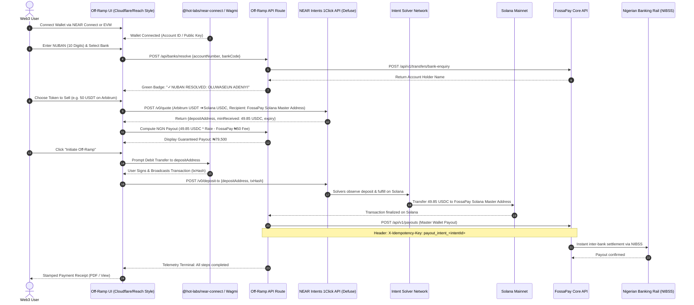

# Project 01 Specification: NEAR Intents Cross-Chain Off-Ramp to Naira

**Status:** Flagship Demo  
**Directory:** `demos/near-offramp/`  
**Primary Technologies:** Next.js (App Router), TypeScript, Tailwind CSS, `@hot-labs/near-connect`, Wagmi / Viem, NEAR Intents (1Click Swap API), FossaPay Core APIs  
**Design System:** Cloudflare Dashboard & [deck.reachapp.xyz](https://deck.reachapp.xyz) (`cf-` design tokens, JetBrains Mono, `#ea580c` Cloudflare Orange)

---

## 1. Executive Summary

The **NEAR Intents Cross-Chain Off-Ramp** is a non-custodial Web3-to-fiat liquidation portal. It allows users across **any blockchain ecosystem** (NEAR, Ethereum, Base, Arbitrum, Bitcoin, Solana) to sell their tokens and receive **instant Nigerian Naira (NGN)** deposited directly into their local bank account in a single transaction.

* **Frontend Design:** Follows the high-density technical aesthetic of Cloudflare & [deck.reachapp.xyz](https://deck.reachapp.xyz) (`.cf-card-dark`, uppercase JetBrains Mono kickers, Cloudflare Orange accents, and crisp `1px solid #334155` borders).
* **Wallet Layer:** Powered by **`@hot-labs/near-connect`** ("NEAR Connect") alongside EVM/Solana connectors, covering the entire spectrum of wallets supported by `near.com` (HOT Wallet, Meteor, HERE, Bitte, Sender, Ledger, and WalletConnect).
* **Intent & Solver Layer:** Powered by NEAR Intents' **1Click Swap API** (`https://1click.chaindefuser.com`), routing user deposits to Solana USDC with zero slippage.
* **Fiat Settlement:** Powered by **FossaPay**, performing real-time NUBAN bank enquiry and instant Master Wallet Payouts across all Nigerian commercial banks and fintechs.

---

## 2. End-to-End System Architecture



---

## 3. Core Component & Directory Architecture

```text
fossapay-demo/
├── packages/
│   └── fossapay-client/             # Shared typed SDK wrapper for FossaPay
│       ├── src/
│       │   ├── client.ts            # Core API client (transfers, payouts, wallets)
│       │   ├── webhooks.ts          # HMAC-SHA256 signature verifier
│       │   └── types.ts             # Complete TypeScript definitions
│       └── test/
│           └── client.test.ts       # Test suite for client and webhook verification
├── demos/
│   └── near-offramp/                 # Next.js App Router Application
│       ├── src/
│       │   ├── app/
│       │   │   ├── layout.tsx       # Root layout with JetBrains Mono + Inter fonts
│       │   │   ├── page.tsx         # Main Off-Ramp terminal page
│       │   │   └── api/
│       │   │       ├── banks/       # Bank directory & enquiry endpoints
│       │   │       ├── quote/       # 1Click quote proxy & NGN conversion
│       │   │       └── webhook/     # FossaPay webhook receiver
│       │   ├── components/
│       │   │   ├── OffRampCard.tsx  # Main swap & destination card (.cf-card-dark)
│       │   │   ├── WalletModal.tsx  # NEAR Connect + EVM connection drawer
│       │   │   ├── Telemetry.tsx    # Live 4-step execution progress monitor
│       │   │   └── Receipt.tsx      # Stamped digital settlement receipt
│       │   └── providers/
│       │       └── Web3Providers.tsx # NEAR Connect + Wagmi context providers
│       ├── tailwind.config.ts       # Configured with Cloudflare/Reach design tokens
│       └── package.json
```

---

## 4. Design System Tokens (Cloudflare + Reach)

The UI directly incorporates the CSS design tokens from `deck.reachapp.xyz`:
* Canvas: `#0f172a` (`bg-slate-950`)
* Cards: `.cf-card-dark` (`#1e293b` surface with `1px solid #334155` border and 12px radius)
* Kickers: `.cf-kicker` (`JetBrains Mono`, uppercase, `11px`, `tracking-[0.2em]`, color `#ea580c`)
* Badges:
  * `.cf-badge-orange`: `color: #ea580c; background: rgba(234, 88, 12, 0.12); border: 1px solid rgba(234, 88, 12, 0.25);`
  * `.cf-badge-green`: `color: #16a34a; background: rgba(22, 163, 74, 0.12); border: 1px solid rgba(22, 163, 74, 0.25);`
  * `.cf-badge-slate`: `color: #94a3b8; background: rgba(148, 163, 184, 0.12); border: 1px solid rgba(148, 163, 184, 0.25);`

---

## 5. Security & Idempotency Rules

1. **Idempotency Keys:** Every payout call transmits `X-Idempotency-Key: payout_intent_<intent_hash>` up to 255 characters to eliminate duplicate debit risks.
2. **Server-Side API Keys:** `FOSSAPAY_API_KEY` is restricted to server routes and never bundled in client code.
3. **Webhook Timing-Safe HMAC:** Webhooks are verified against `JSON.stringify(body.data)` using `crypto.timingSafeEqual` to thwart timing attacks.
