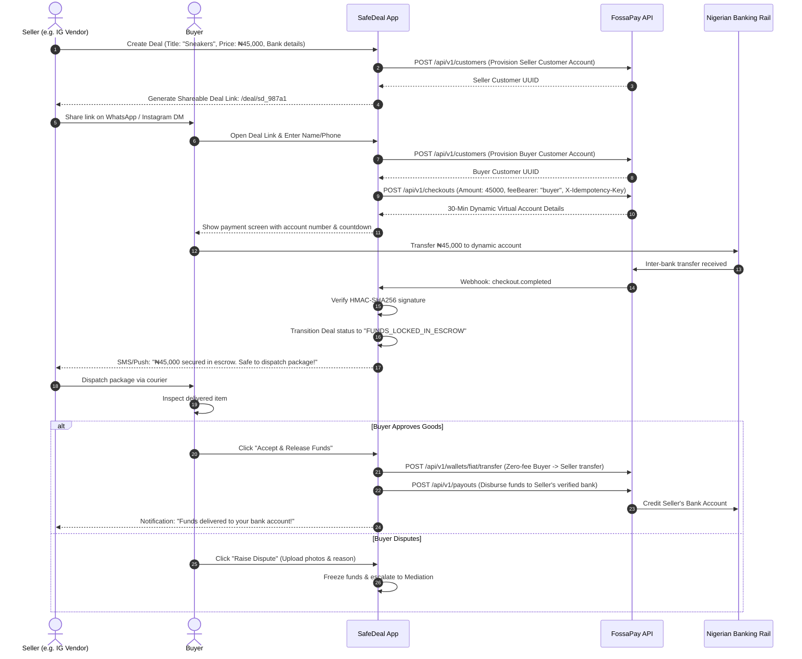

# Project 02 Specification: SafeDeal (P2P Social Commerce Escrow)

**Directory:** `demos/safedeal/`  
**Primary Technologies:** Next.js (App Router), TypeScript, Tailwind CSS, FossaPay Customer & Checkout APIs, Server-Sent Events (SSE)

---

## 1. Executive Summary

In Nigeria, social commerce via Instagram, TikTok, and WhatsApp is plagued by severe trust issues: buyers fear paying upfront and receiving inferior or counterfeit goods ("what I ordered vs what I got"), while sellers lose money on "Pay on Delivery" due to cancelled orders and dispatch logistics costs.

**SafeDeal** is a lightweight, mobile-first P2P escrow web application. A seller creates a deal link with product details and delivery terms. The buyer funds the escrow using a FossaPay dynamic virtual account. The payment is safely locked in escrow until the buyer inspects and approves the delivered goods, at which point funds are released directly to the seller's bank account with zero internal transfer fees.

---

## 2. System Architecture & Escrow Lifecycle



---

## 3. Core Capabilities & User Journey

### 3.1 Deal Creation
* Seller inputs item name, photo/description, price, return/inspection window (e.g., 24 hours), and destination bank account.
* System resolves seller bank details via FossaPay Bank Enquiry (`POST /api/v1/transfers/bank-enquiry`) to ensure payouts cannot bounce.
* Returns a short link (e.g. `safedeal.ng/d/sd_987a1`).

### 3.2 Escrow Deposit
* Buyer opens the link on their mobile device.
* App creates a 30-minute dynamic virtual bank account using FossaPay's Checkout API.
* Upon deposit, FossaPay webhook `checkout.completed` fires.
* SafeDeal locks the deal state to `ESCROW_LOCKED` and notifies the seller that dispatch is authorized.

### 3.3 Zero-Fee Internal Settlement & Payout
* When the buyer confirms delivery, SafeDeal executes FossaPay's **Wallet-to-Wallet Transfer** (`POST /api/v1/wallets/fiat/transfer`). Because both wallets belong to the same merchant account, this transfer is **100% free**.
* The platform then triggers a payout (`POST /api/v1/payouts`) directly to the seller's commercial bank account.

---

## 4. State Machine & Security Model

```text
[DRAFT] -> [WAITING_PAYMENT] -> [ESCROW_LOCKED] -> [DISPATCHED] -> [INSPECTION_PERIOD] -> [RELEASED]
                                                                                       \-> [DISPUTED] -> [REFUNDED]
```

### Dispute & Mediation Safeguards
1. **Inspection Countdown:** A 24-hour timer starts once delivery tracking confirms drop-off. If the buyer takes no action and raises no dispute within 24 hours, the system automatically releases funds to the seller.
2. **Dispute Lock:** If the buyer flags a discrepancy, funds remain frozen in the escrow wallet until both parties agree or a platform mediator reviews evidence.
3. **Refunds:** In case of a dispute resolution in favor of the buyer, funds are refunded to the buyer's bank account via Master Wallet Payout.
