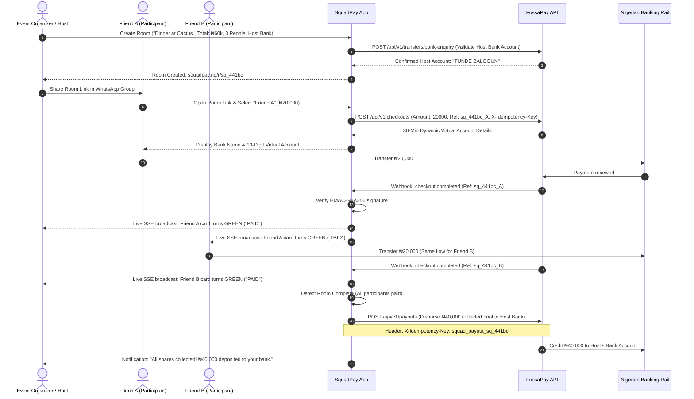

# Project 03 Specification: SquadPay (Live Group Bill Splitter)

**Directory:** `demos/squadpay/`  
**Primary Technologies:** Next.js (App Router), TypeScript, Tailwind CSS, Server-Sent Events (SSE), FossaPay Checkouts & Payouts

---

## 1. Executive Summary

Traditional bill-splitting apps like Splitwise only manage a ledger of IOUs; they do not collect or move money. In Nigeria, settling group dinners, vacation Airbnbs, or shared birthday gifts requires one person to share their personal account number, manually check banking notifications, match transfer alerts, and chase friends who forgot to pay.

**SquadPay** bridges expense splitting with automated settlement. A host inputs the total bill and participant names. SquadPay generates an interactive room with individual payment cards. Each participant pays their share via an instant dynamic bank transfer. As payments settle, the room updates in real time, and the complete pooled amount is automatically paid out to the host's bank account.

---

## 2. System Architecture & Live Settlement Flow

---

## 3. Core Features & User Journey

### 3.1 Room Creation
* Host sets room name, total bill, split mode:
  * **Equal Split:** Divided evenly across N people.
  * **Custom Itemized Split:** Specific items/amounts assigned to specific friends.
* Host provides their Nigerian bank account number and bank code. FossaPay's Bank Enquiry verifies the account holder name immediately.
* SquadPay generates a persistent room ID and shareable URL.

### 3.2 Participant Checkout Cards
* Each participant taps their name on the room board.
* Generates a 30-minute dynamic virtual account (`POST /api/v1/checkouts`) tied to their participant reference (`squad_{roomId}_{participantId}`).
* Displays a countdown timer, account number, bank name, and copy button.

### 3.3 Real-Time SSE Synchronization
* The room board maintains a lightweight Server-Sent Events (SSE) connection (`/api/rooms/{id}/stream`).
* When FossaPay delivers the `checkout.completed` webhook for any participant, the backend broadcasts a status update.
* All open browser sessions instantly see the participant's card illuminate green with a checkmark.

### 3.4 Automated Host Disbursement
* Once all required shares are collected, the backend calculates the final pool and triggers a single Master Wallet Payout (`POST /api/v1/payouts`) to the host's bank.
* The host receives a stamped receipt and payout reference.

---

## 4. Edge Cases & Resilience

1. **Checkout Expiry:** If a participant does not pay within 30 minutes, their checkout expires (`checkout.expired`). They can click "Regenerate Account" to receive a fresh 30-minute account without altering other participants' statuses.
2. **Partial Settlements:** If 3 out of 4 friends pay, the host can click "Close Room & Withdraw Partial Pool". SquadPay triggers the payout for the collected amount and marks the non-paying friend as "Unsettled".
3. **Idempotency Protection:** Host payouts are strictly keyed to `squad_payout_{roomId}` to prevent duplicate disbursements if the completion trigger is retried.
