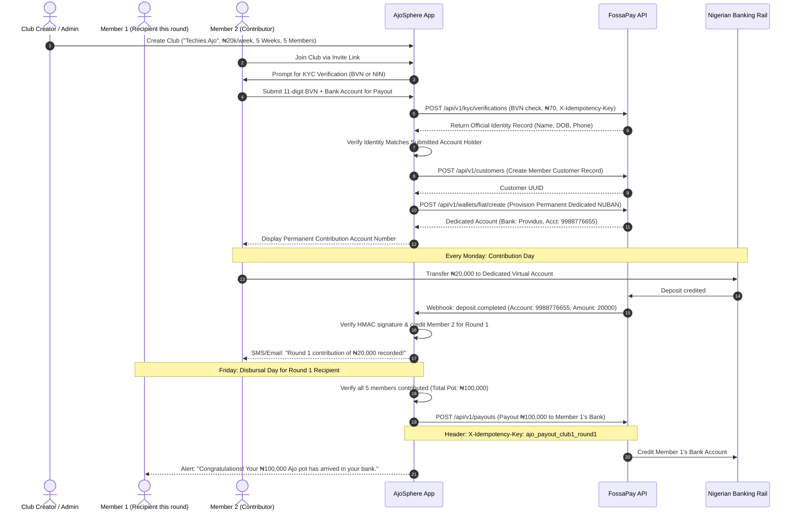

# Project 04 Specification: AjoSphere (Digital Rotating Savings Club)

**Directory:** `demos/ajosphere/`  
**Primary Technologies:** Next.js (App Router), TypeScript, Tailwind CSS, FossaPay Dedicated Virtual Accounts, KYC & Payout APIs

---

## 1. Executive Summary

*Ajo* (Yoruba) or *Esusu* (Igbo) is a centuries-old community banking tradition in West Africa where a group of trusted individuals contribute a fixed amount at regular intervals (weekly or monthly). In each cycle, one member collects the full lump sum pot.

Traditional paper-and-cash Ajo clubs suffer from ledger tampering, manual collection friction, and untraceable defaulters. **AjoSphere** digitizes this experience:
1. Members undergo automated official **NIN/BVN identity verification** during onboarding.
2. Each member receives a **permanent dedicated NUBAN virtual account** for automated contributions.
3. The platform tracks weekly deposits via webhooks and automatically disburses the accumulated pot to the round's recipient via direct bank payout.

---

## 2. System Architecture & Rotation Lifecycle



---

## 3. Core Modules & User Journey

### 3.1 Trust & Identity Verification (KYC)
* To prevent fraud and defaulters, every member must pass a real-time Nigerian identity check during onboarding.
* AjoSphere calls FossaPay's KYC endpoint:
  ```json
  POST /api/v1/kyc/verifications
  Headers:
    x-api-key: $FOSSAPAY_API_KEY
    X-Idempotency-Key: kyc_member_0182_bvn
  Body:
  {
    "method": "BVN",
    "identityNumber": "22233344455"
  }
  ```
* Validates the member's legal name against the payout bank account provided, preventing pseudonym fraud.

### 3.2 Permanent Dedicated Virtual Accounts
* Unlike 30-minute checkouts, Ajo contributions happen repeatedly.
* AjoSphere provisions a permanent virtual account for each member (`POST /api/v1/wallets/fiat/create`).
* Members can save this account number in their banking apps (e.g. as a recurring scheduled transfer).
* Whenever funds land, FossaPay delivers a `deposit.completed` webhook.

### 3.3 Automated Scheduled Rotation
* The club dashboard displays a rotation calendar showing who collects in Round 1, Round 2, Round 3, etc.
* On the scheduled payout date, AjoSphere verifies that the required pot is fulfilled and triggers a FossaPay Master Wallet Payout directly into the round recipient's bank account.

---

## 4. Club Governance & Defaulter Mitigation

1. **Contribution Window & Grace Period:** Members have from Monday 00:00 to Thursday 23:59 to deposit. On Friday 09:00, the pot is disbursed.
2. **Late Alerts & Automated Reminders:** The system monitors incoming deposits and sends automated SMS/email reminders to uncredited members.
3. **Audit Ledger:** Every member has access to an immutable transaction log showing exact timestamps when each member's deposit was confirmed.
